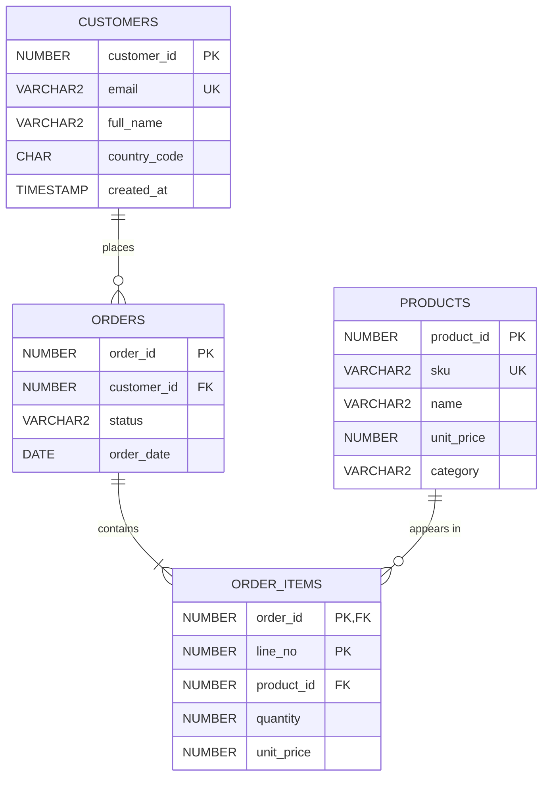
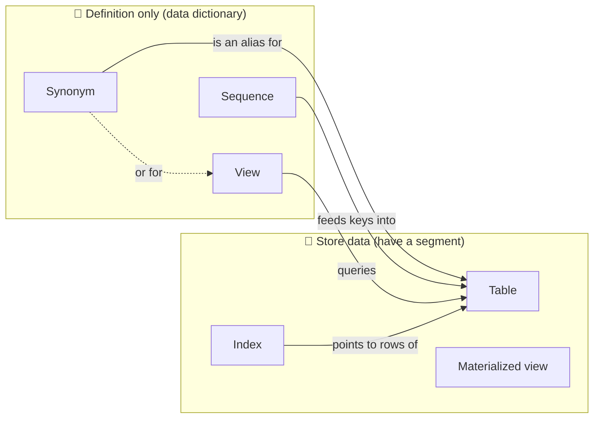

# 🗄️ Oracle RDBMS Basics for Developers

> A hands-on, bite-sized course on the core building blocks of the Oracle Database — written for developers who use Oracle every day but never had a proper introduction.

**Target version:** Oracle Database **19c** (everything here also works on 21c / 23ai unless noted).

---

## 🎯 Who is this for?

- Application developers who write SQL against Oracle but want to understand *what is actually happening* underneath.
- Engineers coming from PostgreSQL / MySQL / SQL Server who need the "Oracle way" of doing things.
- Anyone preparing to design schemas, review DDL, or troubleshoot performance on Oracle.

You should already know basic SQL (`SELECT`, `INSERT`, `UPDATE`, `DELETE`, `JOIN`). No DBA knowledge required.

---

## 🧭 Course map

Each lesson is split into **short knowledge sessions** (≈ 5–10 minutes each). Every session has one key idea, a runnable example, and the gotchas that bite developers in real life.

| # | Lesson | What you'll learn | Sessions | Time |
|---|--------|-------------------|:--------:|:----:|
| 0 | [Setup](lessons/00-setup.md) | Get a training schema and a SQL client ready | 3 | 15 min |
| 1 | [Tables](lessons/01-tables.md) | Data types, constraints, identity columns, DDL, table types | 7 | 60 min |
| 2 | [Segments & Storage](lessons/02-segments.md) | Tablespaces, segments, extents, blocks, the high water mark | 6 | 45 min |
| 3 | [Indexes](lessons/03-indexes.md) | B-trees, execution plans, composite & function-based indexes | 8 | 70 min |
| 4 | [Views](lessons/04-views.md) | Stored queries, DML through views, dependencies | 6 | 45 min |
| 5 | [Sequences](lessons/05-sequences.md) | Number generators, caching, gaps, identity columns | 6 | 40 min |
| 6 | [Synonyms](lessons/06-synonyms.md) | Aliases, name resolution, privileges | 5 | 30 min |
| 📋 | [Cheat Sheet](lessons/99-cheatsheet.md) | Dictionary views, commands, common errors — on one page | — | — |

> [!TIP]
> Do the lessons **in order**. Lesson 1 builds the sample schema that every later lesson uses. In a hurry? Run the [fast-track script](lessons/01-tables.md#-fast-track-script) and jump anywhere.

---

## 🛒 The sample schema

All lessons share one tiny online-shop schema, so you can focus on concepts instead of new tables every time.

---

## 🧩 The big picture

Every object in this course is a **schema object** — it belongs to a user (schema). Only some of them actually *store data*:

Keep this picture in mind — it explains a lot of behaviour you'll see along the way.

---

## 📖 How to read the lessons

Throughout the material you'll see these markers:

| Marker | Meaning |
|--------|---------|
| 🧠 **Key idea** | The one thing to remember from a session |
| 🧪 **Try it** | SQL to run in your training schema |
| > [!WARNING] | A gotcha that causes real bugs or outages |
| > [!TIP] | A habit that will make your life easier |
| > [!NOTE] | Background info / version-specific details |
| ✅ **Check yourself** | A short quiz — answers are folded away |

---

## 📚 Further reading

- [Oracle Database 19c Concepts](https://docs.oracle.com/en/database/oracle/oracle-database/19/cncpt/) — the best "why" book Oracle has ever written. Free.
- [Oracle Database 19c SQL Language Reference](https://docs.oracle.com/en/database/oracle/oracle-database/19/sqlrf/) — exact syntax for every statement.
- [Oracle Database 19c Reference](https://docs.oracle.com/en/database/oracle/oracle-database/19/refrn/) — all data dictionary views and parameters.

---

<b>Ready?</b> → <a href="lessons/00-setup.md">Start with the setup</a>

