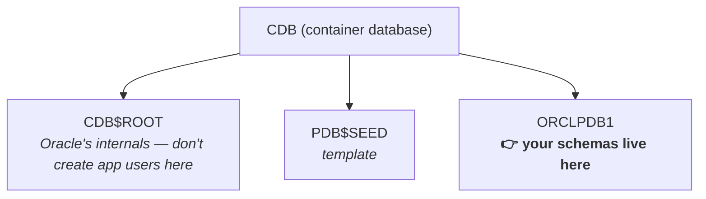

# 0️⃣ Setup

> Get a safe playground: your own schema in a 19c database and a SQL client.

**Sessions:** 3 · **Time:** ~15 min

---

## Session 0.1 — What you need

| Item | Options |
|------|---------|
| **An Oracle 19c database** | A shared dev/test database at work, or a local one (e.g. built from Oracle's official container images at [github.com/oracle/docker-images](https://github.com/oracle/docker-images/tree/main/OracleDatabase/SingleInstance)) |
| **A SQL client** | [SQLcl](https://www.oracle.com/database/sqldeveloper/technologies/sqlcl/) (modern CLI), [SQL Developer](https://www.oracle.com/database/sqldeveloper/) (GUI), VS Code with the Oracle SQL Developer extension, or classic SQL\*Plus |
| **Someone with DBA rights** | Only once — to create your training users |

🧠 **Key idea:** since 12c, Oracle is a **multitenant** database. The container (CDB) holds one or more **pluggable databases (PDBs)**. Applications — and you — always work inside a **PDB**, never in the CDB root.



> [!WARNING]
> If `CREATE USER rdbms_dev ...` fails with *"ORA-65096: invalid common user or role name"*, you're connected to the **CDB root**. Connect to the PDB service instead (e.g. `//localhost:1521/ORCLPDB1`).

---

## Session 0.2 — Create the training users

Ask a DBA (or use `SYSTEM` on your local database) to run this **inside the PDB**:

```sql
-- 👤 Main training schema: owns all objects in this course
CREATE USER rdbms_dev IDENTIFIED BY "Change_Me_123"
  DEFAULT TABLESPACE users
  QUOTA 200M ON users;

GRANT CREATE SESSION,
      CREATE TABLE,
      CREATE VIEW,
      CREATE MATERIALIZED VIEW,
      CREATE SEQUENCE,
      CREATE SYNONYM,
      CREATE PROCEDURE
   TO rdbms_dev;

-- 👤 Second user: plays "the application" in the synonyms lesson
CREATE USER rdbms_app IDENTIFIED BY "Change_Me_456";
GRANT CREATE SESSION, CREATE SYNONYM TO rdbms_app;

-- 🌍 Optional: only needed for the public-synonym demo in lesson 6
GRANT CREATE PUBLIC SYNONYM, DROP PUBLIC SYNONYM TO rdbms_dev;
```

> [!NOTE]
> - In Oracle, **user = schema**. Creating user `RDBMS_DEV` creates an (empty) schema `RDBMS_DEV`; every object it creates lives there.
> - `QUOTA ... ON users` is what lets the user actually *store* data. You'll see why in [lesson 2](02-segments.md).
> - We deliberately grant individual privileges instead of the `RESOURCE` or `DBA` roles — least privilege is a good habit even in training.

---

## Session 0.3 — Connect and tune your client

```bash
# SQLcl (prompts for the password)
sql rdbms_dev@//localhost:1521/ORCLPDB1

# SQL*Plus
sqlplus rdbms_dev@//localhost:1521/ORCLPDB1
```

Then make the output readable. Run these at the start of every session (or put them in a `login.sql`):

```sql
SET LINESIZE 200
SET PAGESIZE 100
SET SERVEROUTPUT ON
ALTER SESSION SET NLS_DATE_FORMAT      = 'YYYY-MM-DD HH24:MI:SS';
ALTER SESSION SET NLS_TIMESTAMP_FORMAT = 'YYYY-MM-DD HH24:MI:SS.FF3';
```

🧪 **Try it** — confirm who and where you are:

```sql
SELECT USER                                   AS connected_as,
       SYS_CONTEXT('USERENV', 'CON_NAME')     AS container,
       SYS_CONTEXT('USERENV', 'CURRENT_SCHEMA') AS current_schema
FROM   dual;

SELECT banner_full FROM v$version;   -- should mention 19c
```

> [!TIP]
> `DUAL` is a special one-row, one-column table that every Oracle database has. Use it whenever you need to `SELECT` an expression without a real table: `SELECT SYSDATE FROM dual;`

---

## 🧹 Reset script

Made a mess? This drops **everything** in the current schema so you can start over.

> [!CAUTION]
> Run this **only** while connected as `RDBMS_DEV`. It deletes every table, view, sequence and synonym in the current schema without asking.

```sql
BEGIN
  IF USER <> 'RDBMS_DEV' THEN
    RAISE_APPLICATION_ERROR(-20000, 'Refusing to run: connected as ' || USER);
  END IF;

  FOR o IN (SELECT object_name, object_type
            FROM   user_objects
            WHERE  object_type IN ('VIEW', 'MATERIALIZED VIEW', 'SYNONYM', 'TABLE', 'SEQUENCE')
            AND    object_name NOT LIKE 'ISEQ$$%'   -- identity sequences go away with their table
            ORDER  BY DECODE(object_type, 'MATERIALIZED VIEW', 1, 'VIEW', 2,
                                          'SYNONYM', 3, 'TABLE', 4, 5))
  LOOP
    BEGIN
      EXECUTE IMMEDIATE
        CASE o.object_type
          WHEN 'TABLE' THEN 'DROP TABLE "' || o.object_name || '" CASCADE CONSTRAINTS PURGE'
          ELSE 'DROP ' || o.object_type || ' "' || o.object_name || '"'
        END;
    EXCEPTION
      WHEN OTHERS THEN NULL;  -- already gone (e.g. MV container table)
    END;
  END LOOP;
END;
/
```

---

<p align="center"><a href="../README.md">🏠 Home</a> · <a href="01-tables.md">Next: Tables →</a></p>
