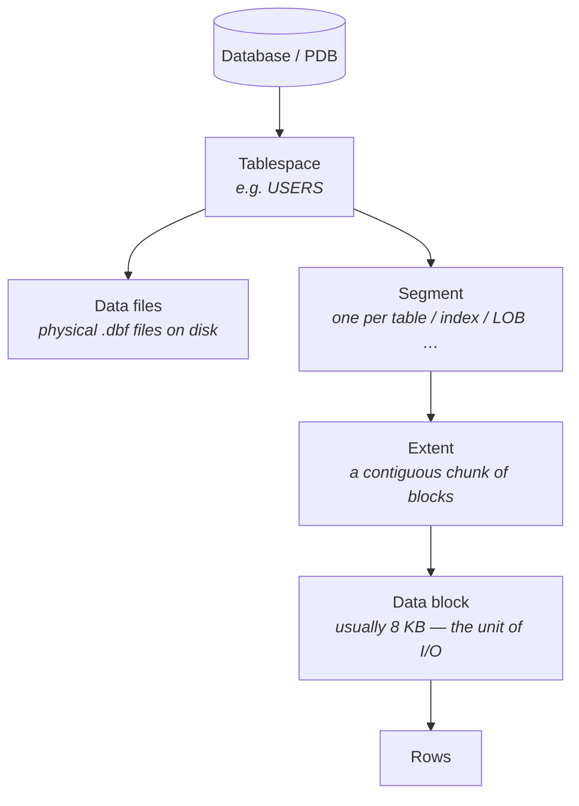

# 2️⃣ Segments & Storage

> Where do the bytes actually go? Understanding storage explains why `DELETE` doesn't free space, why an empty table can be slow to scan, and why some objects "take up no space at all".

**Sessions:** 6 · **Time:** ~45 min · **Requires:** sample schema from [lesson 1](01-tables.md)

---

## 📑 Sessions

1. [The storage hierarchy](#session-21--the-storage-hierarchy)
2. [Which objects have segments?](#session-22--which-objects-have-segments)
3. [Deferred segment creation](#session-23--deferred-segment-creation)
4. [Extents and blocks](#session-24--extents-and-blocks)
5. [The high water mark](#session-25--the-high-water-mark)
6. [Rows inside blocks](#session-26--rows-inside-blocks)

---

## Session 2.1 — The storage hierarchy

🧠 **Key idea:** Oracle separates **logical** storage (what you see) from **physical** storage (files on disk).



| Level | What it is | Analogy |
|-------|------------|---------|
| **Tablespace** | A named storage area, made of one or more data files | A warehouse |
| **Segment** | All the storage that belongs to **one** object | One company's rented area |
| **Extent** | A contiguous chunk of blocks added to a segment as it grows | A shelf unit |
| **Block** | The smallest unit Oracle reads or writes | A box on the shelf |

> [!NOTE]
> Oracle **never reads a single row from disk** — it reads whole blocks (8 KB by default). That's why "how many blocks does this query touch?" is the real measure of I/O cost.

🧪 **Try it:**

```sql
SELECT tablespace_name, block_size, extent_management, allocation_type, segment_space_management
FROM   user_tablespaces;

-- Your quota: MAX_BYTES = -1 means unlimited
SELECT tablespace_name, ROUND(bytes/1024/1024, 1) AS used_mb, max_bytes/1024/1024 AS quota_mb
FROM   user_ts_quotas;
```

> [!WARNING]
> No quota, no data. A user without quota on a tablespace can `CREATE TABLE` (thanks to deferred segment creation — see 2.3), but the first `INSERT` fails with **`ORA-01950: no privileges on tablespace 'USERS'`**. Running out of quota gives **`ORA-01536: space quota exceeded`**.

---

## Session 2.2 — Which objects have segments?

🧠 **Key idea:** only objects that **store data** have a segment. Everything else is just a row in the data dictionary.

| Object | Has a segment? | Why |
|--------|:--------------:|-----|
| Table | ✅ | Stores rows |
| Index | ✅ | Stores keys + ROWIDs |
| LOB column (`CLOB`/`BLOB`) | ✅ (extra ones) | Large values live in their own LOB segment + LOB index |
| Partition | ✅ (one each) | Every partition is its own segment |
| Materialized view | ✅ | Stores the query result |
| **View** | ❌ | Just a stored `SELECT` |
| **Sequence** | ❌ | Just a counter in the dictionary |
| **Synonym** | ❌ | Just an alias |

🧪 **Try it:**

```sql
SELECT segment_name, segment_type, tablespace_name,
       ROUND(bytes/1024, 0) AS kb, blocks, extents
FROM   user_segments
ORDER  BY segment_type, segment_name;
```

You should see the four tables and their primary/unique key indexes (e.g. `CUSTOMERS_PK`, `CUSTOMERS_EMAIL_UK`) — one table can easily own several segments.

---

## Session 2.3 — Deferred segment creation

🧠 **Key idea:** since 11gR2, `CREATE TABLE` **doesn't allocate any space** until the first row is inserted (`DEFERRED_SEGMENT_CREATION = TRUE` by default). Empty tables cost nothing.

🧪 **Try it:**

```sql
CREATE TABLE seg_demo (
  id       NUMBER,
  padding  VARCHAR2(1000)
);

SELECT segment_name FROM user_segments WHERE segment_name = 'SEG_DEMO';
-- no rows selected 👻  — the table exists, its segment doesn't

SELECT table_name, segment_created FROM user_tables WHERE table_name = 'SEG_DEMO';
-- SEGMENT_CREATED = NO

INSERT INTO seg_demo VALUES (1, 'hello');
COMMIT;

SELECT segment_name, bytes/1024 AS kb, extents FROM user_segments WHERE segment_name = 'SEG_DEMO';
-- now it exists: 64 KB, 1 extent
```

> [!TIP]
> Want the segment right away (e.g. to detect a missing quota at deploy time rather than at the first insert in production)? Use `CREATE TABLE t (...) SEGMENT CREATION IMMEDIATE;`

---

## Session 2.4 — Extents and blocks

🧠 **Key idea:** segments grow **one extent at a time**. With the default `AUTOALLOCATE` policy, extents start small (64 KB) and get bigger as the segment grows (1 MB, 8 MB, 64 MB …), so small tables stay small and big tables don't need thousands of extents.

🧪 **Try it** — grow the segment and watch the extents appear:

```sql
INSERT INTO seg_demo
SELECT LEVEL, RPAD('x', 1000, 'x')
FROM   dual
CONNECT BY LEVEL <= 20000;      -- ~20 MB of rows
COMMIT;

SELECT segment_name, ROUND(bytes/1024/1024, 1) AS mb, blocks, extents
FROM   user_segments
WHERE  segment_name = 'SEG_DEMO';

SELECT bytes/1024 AS extent_kb, COUNT(*) AS how_many
FROM   user_extents
WHERE  segment_name = 'SEG_DEMO'
GROUP  BY bytes
ORDER  BY bytes;
```

Typical result: a run of 64 KB extents, followed by 1 MB extents.

> [!NOTE]
> `CONNECT BY LEVEL <= n` against `DUAL` is the classic Oracle trick for generating `n` rows. You'll use it a lot to create test data.

---

## Session 2.5 — The high water mark

🧠 **Key idea:** the **high water mark (HWM)** is the boundary between blocks that have *ever* held data and blocks that never have. **Full table scans read every block up to the HWM** — even empty ones.

```text
Segment SEG_DEMO
┌────┬────┬────┬────┬────┬────┬────┬────┬────┬────┐
│████│████│████│░░░░│░░░░│░░░░│░░░░│    │    │    │
└────┴────┴────┴────┴────┴────┴────┴────┴────┴────┘
 used blocks  emptied by DELETE      ▲   never used
                                     │
                               high water mark
 ◄──── a full scan reads all of this ──►
```

🧪 **Try it:**

```sql
EXEC DBMS_STATS.GATHER_TABLE_STATS(USER, 'SEG_DEMO');
SELECT num_rows, blocks FROM user_tables WHERE table_name = 'SEG_DEMO';   -- ~20000 rows, ~2900 blocks

DELETE FROM seg_demo;
COMMIT;

EXEC DBMS_STATS.GATHER_TABLE_STATS(USER, 'SEG_DEMO');
SELECT num_rows, blocks FROM user_tables WHERE table_name = 'SEG_DEMO';   -- 0 rows, still ~2900 blocks 😱
SELECT bytes/1024/1024 AS mb FROM user_segments WHERE segment_name = 'SEG_DEMO';  -- still ~20 MB
```

The table is empty, but a `SELECT COUNT(*)` still reads ~2900 blocks. The freed space **can be reused by new rows in this table**, but it's not given back to the tablespace.

How to lower the HWM and release space:

| Method | Statement | Notes |
|--------|-----------|-------|
| Remove all rows | `TRUNCATE TABLE seg_demo;` | Instant. Keeps only the first extent. `DROP ALL STORAGE` removes even that. |
| Compact in place | `ALTER TABLE seg_demo ENABLE ROW MOVEMENT;`<br/>`ALTER TABLE seg_demo SHRINK SPACE;` | Online; keeps the data. Needs an ASSM tablespace (the default). |
| Rebuild the table | `ALTER TABLE seg_demo MOVE ONLINE;` | 12.2+ online move keeps indexes usable. |

```sql
TRUNCATE TABLE seg_demo;
SELECT bytes/1024 AS kb, extents FROM user_segments WHERE segment_name = 'SEG_DEMO';   -- back to 64 KB
```

> [!WARNING]
> `ALTER TABLE ... MOVE` **without** `ONLINE` (or `UPDATE INDEXES`) changes every ROWID and marks all the table's indexes **`UNUSABLE`**. Queries that depend on them suddenly do full scans — or fail. Check `user_indexes.status` after any move.

---

## Session 2.6 — Rows inside blocks

🧠 **Key idea:** a block holds a small header, a row directory, and the rows. A `ROWID` says exactly **which object, file, block and slot** a row lives in.

```text
┌─────────────── 8 KB data block ───────────────┐
│ Block header · transaction slots               │
│ Row directory (slot → offset)                  │
│ ...free space (PCTFREE reserved for updates)...│
│ Row 3 │ Row 2 │ Row 1                          │
└────────────────────────────────────────────────┘
```

🧪 **Try it** — decode the ROWIDs of your customers:

```sql
SELECT full_name,
       ROWID,
       DBMS_ROWID.ROWID_RELATIVE_FNO(ROWID) AS file_no,
       DBMS_ROWID.ROWID_BLOCK_NUMBER(ROWID) AS block_no,
       DBMS_ROWID.ROWID_ROW_NUMBER(ROWID)   AS slot
FROM   customers;
```

All four customers probably share **one block** — reading any of them costs the same single block read.

Two terms you'll hear from DBAs:

- **`PCTFREE`** (default 10%) — space kept free in each block so rows can grow on `UPDATE`.
- **Row migration / chaining** — when an updated row no longer fits in its block, it moves (migration) or spans several blocks (chaining). Each access then needs extra block reads. Usually a sign of rows that start small and get much bigger later.

Clean up:

```sql
DROP TABLE seg_demo PURGE;
```

---

## ✅ Check yourself

<details>
<summary><b>1.</b> You create a table, never insert anything, and query <code>USER_SEGMENTS</code>. What do you see?</summary>

**Nothing.** With deferred segment creation, the segment is only created on the first insert. `USER_TABLES.SEGMENT_CREATED` shows `NO`.
</details>

<details>
<summary><b>2.</b> Which of these consume storage: a view, an index, a sequence, a synonym, a materialized view?</summary>

**The index and the materialized view.** Views, sequences and synonyms are dictionary entries only.
</details>

<details>
<summary><b>3.</b> A 10 GB table had 99% of its rows deleted. Why is <code>SELECT COUNT(*)</code> still slow?</summary>

The **high water mark** didn't move. A full scan still reads every block below it, including the empty ones. Lower it with `SHRINK SPACE`, `MOVE ONLINE`, or (if all rows are gone) `TRUNCATE`.
</details>

<details>
<summary><b>4.</b> Your deployment creates tables fine, but the app crashes on the first insert with ORA-01950. What's missing?</summary>

A **tablespace quota** for the schema owner. Deferred segment creation hid the problem until the first row needed space.
</details>

---

<p align="center"><a href="01-tables.md">← Tables</a> · <a href="../README.md">🏠 Home</a> · <a href="03-indexes.md">Next: Indexes →</a></p>
