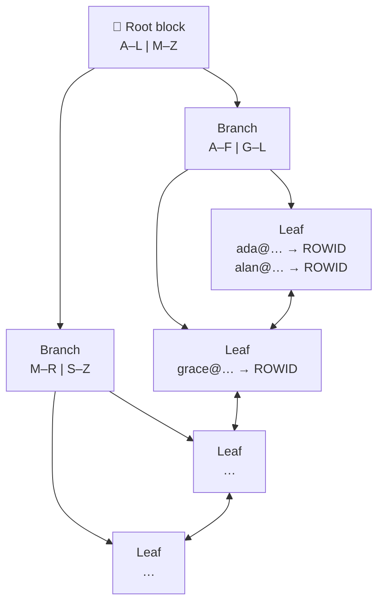

# 3️⃣ Indexes

> Indexes are the single biggest performance lever a developer controls. They make reads fast — and every write a little slower.

**Sessions:** 8 · **Time:** ~70 min · **Requires:** sample schema from [lesson 1](01-tables.md)

---

## 📑 Sessions

1. [Why indexes exist](#session-31--why-indexes-exist)
2. [Inside a B-tree](#session-32--inside-a-b-tree)
3. [Reading an execution plan](#session-33--reading-an-execution-plan)
4. [Indexes you get for free (and the one you don't)](#session-34--indexes-you-get-for-free-and-the-one-you-dont)
5. [Composite indexes and column order](#session-35--composite-indexes-and-column-order)
6. [When an index can't be used](#session-36--when-an-index-cant-be-used)
7. [Other index types](#session-37--other-index-types)
8. [Living with indexes](#session-38--living-with-indexes)

---

## Session 3.1 — Why indexes exist

🧠 **Key idea:** an index is a **separate, sorted structure** that maps column values to `ROWID`s. Like the index at the back of a book: look up the word, get the page number, jump straight there.

| Without an index | With an index |
|------------------|---------------|
| **Full table scan**: read every block up to the HWM | Walk the index (a few blocks), then fetch the row by ROWID |
| Cost grows with table size | Cost stays almost flat |

But indexes are **not free**:

- They take **space** — every index is its own [segment](02-segments.md#session-22--which-objects-have-segments).
- Every `INSERT`, `DELETE`, and `UPDATE` of an indexed column must **also update the index**.

🧪 **Try it** — create a table big enough to feel the difference:

```sql
CREATE TABLE idx_demo AS
SELECT LEVEL                                   AS id,
       'user' || LEVEL || '@example.com'       AS email,
       MOD(LEVEL, 5)                           AS status_code,
       DATE '2024-01-01' + MOD(LEVEL, 365)     AS created_on,
       RPAD('x', 100, 'x')                     AS padding
FROM   dual
CONNECT BY LEVEL <= 100000;

EXEC DBMS_STATS.GATHER_TABLE_STATS(USER, 'IDX_DEMO');
```

---

## Session 3.2 — Inside a B-tree

🧠 **Key idea:** the default index type is a **balanced tree (B-tree)**. Every lookup walks from the root to a leaf — and the tree is so wide that even millions of rows need only **2–4 levels**.



- **Leaf blocks** hold `(key, ROWID)` pairs, **sorted** by key, and are linked to their neighbours — perfect for range scans (`BETWEEN`, `>`, `LIKE 'abc%'`).
- **`BLEVEL`** = number of levels above the leaves. A B-tree is always balanced: every leaf is the same distance from the root.

> [!NOTE]
> A B-tree index is **self-balancing**. The old advice "rebuild your indexes regularly" is almost always a waste of time on modern Oracle.

---

## Session 3.3 — Reading an execution plan

🧠 **Key idea:** the **optimizer** decides how to run your query. `EXPLAIN PLAN` shows you its decision. Learn to read it before you add or blame an index.

🧪 **Try it** — before the index:

```sql
EXPLAIN PLAN FOR
SELECT * FROM idx_demo WHERE email = 'user4242@example.com';

SELECT * FROM TABLE(DBMS_XPLAN.DISPLAY(format => 'BASIC +ROWS +COST'));
```

```text
-------------------------------------------------------
| Id  | Operation         | Name     | Rows  | Cost  |
-------------------------------------------------------
|   0 | SELECT STATEMENT  |          |     1 |   ~450|
|   1 |  TABLE ACCESS FULL| IDX_DEMO |     1 |   ~450|
-------------------------------------------------------
```

Now add an index and look again:

```sql
CREATE UNIQUE INDEX idx_demo_email_ux ON idx_demo (email);

EXPLAIN PLAN FOR
SELECT * FROM idx_demo WHERE email = 'user4242@example.com';

SELECT * FROM TABLE(DBMS_XPLAN.DISPLAY(format => 'BASIC +ROWS +COST'));
```

```text
-----------------------------------------------------------------------
| Id  | Operation                   | Name              | Rows | Cost |
-----------------------------------------------------------------------
|   0 | SELECT STATEMENT            |                   |    1 |    3 |
|   1 |  TABLE ACCESS BY INDEX ROWID| IDX_DEMO          |    1 |    3 |
|   2 |   INDEX UNIQUE SCAN         | IDX_DEMO_EMAIL_UX |    1 |    2 |
-----------------------------------------------------------------------
```

Read plans **inside out**: step 2 (find the ROWID in the index) feeds step 1 (fetch the row). Cost dropped from hundreds to ~3.

| Operation | Meaning |
|-----------|---------|
| `TABLE ACCESS FULL` | Read all blocks up to the HWM |
| `INDEX UNIQUE SCAN` | Find **at most one** entry (unique index, `=`) |
| `INDEX RANGE SCAN` | Find a **range** of entries (non-unique, `<`, `BETWEEN`, `LIKE 'x%'`) |
| `TABLE ACCESS BY INDEX ROWID [BATCHED]` | Fetch rows using ROWIDs from the index |
| `INDEX FAST FULL SCAN` | Read the whole index like a small table |
| `INDEX SKIP SCAN` | Use a composite index without its leading column (see 3.5) |

> [!TIP]
> `EXPLAIN PLAN` shows what the optimizer *would* do. To see what *actually* happened for a statement you just ran, use `SELECT * FROM TABLE(DBMS_XPLAN.DISPLAY_CURSOR(format => 'ALLSTATS LAST'));` (needs `SELECT` on a few `V$` views — ask your DBA, or use SQL Developer's "Autotrace").

---

## Session 3.4 — Indexes you get for free (and the one you don't)

🧠 **Key idea:** `PRIMARY KEY` and `UNIQUE` constraints **create (or reuse) an index automatically**. **Foreign keys do not.**

🧪 **Try it:**

```sql
SELECT i.table_name, i.index_name, i.uniqueness, LISTAGG(c.column_name, ', ')
         WITHIN GROUP (ORDER BY c.column_position) AS columns
FROM   user_indexes i
JOIN   user_ind_columns c ON c.index_name = i.index_name
WHERE  i.table_name IN ('CUSTOMERS', 'ORDERS', 'ORDER_ITEMS', 'PRODUCTS')
GROUP  BY i.table_name, i.index_name, i.uniqueness
ORDER  BY i.table_name;
```

Now compare with the foreign keys from lesson 1:

| Foreign key | Column | Indexed? |
|-------------|--------|:--------:|
| `ORDERS_CUSTOMER_FK` | `orders.customer_id` | ❌ |
| `ORDER_ITEMS_ORDER_FK` | `order_items.order_id` | ✅ leading column of `ORDER_ITEMS_PK` |
| `ORDER_ITEMS_PRODUCT_FK` | `order_items.product_id` | ❌ |

> [!WARNING]
> **Unindexed foreign keys** hurt in two ways:
> 1. **Slow joins and lookups** — "all orders of customer X" scans the whole `ORDERS` table.
> 2. **Locking** — deleting a parent row (or updating its key) has to check the child table. Without an index, Oracle locks the **entire child table** while it checks — a classic cause of mysterious blocking in OLTP apps.

Fix them:

```sql
CREATE INDEX orders_customer_ix      ON orders (customer_id);
CREATE INDEX order_items_product_ix  ON order_items (product_id);
```

> [!TIP]
> Rule of thumb: **index every foreign key** unless you're certain the parent is never deleted or updated *and* you never join or filter from parent to child.

---

## Session 3.5 — Composite indexes and column order

🧠 **Key idea:** an index on `(a, b)` is sorted by `a` first, then by `b` within each `a`. It's great for `WHERE a = ?` and `WHERE a = ? AND b = ?` — but much less useful for `WHERE b = ?` alone. **Column order matters.**

```text
Index on (status_code, created_on)
status_code │ created_on  │ ROWID
────────────┼─────────────┼──────
0           │ 2024-01-05  │ …
0           │ 2024-01-10  │ …
1           │ 2024-01-01  │ …
1           │ 2024-01-06  │ …      ← WHERE status_code = 1 AND created_on > …
1           │ 2024-02-11  │ …         = one contiguous slice of the index ✅
2           │ …           │ …
```

🧪 **Try it:**

```sql
CREATE INDEX idx_demo_status_date_ix ON idx_demo (status_code, created_on);

EXPLAIN PLAN FOR
SELECT status_code, created_on
FROM   idx_demo
WHERE  status_code = 3
AND    created_on >= DATE '2024-12-01';

SELECT * FROM TABLE(DBMS_XPLAN.DISPLAY(format => 'BASIC +ROWS'));
-- INDEX RANGE SCAN only — no TABLE ACCESS at all!
```

That last point is worth repeating: when **every column the query needs is in the index**, Oracle never touches the table. That's called a **covering index**.

Guidelines for choosing column order:

1. Columns used with **`=`** go first, range conditions (`>`, `BETWEEN`) last.
2. Put the column that's **always present** in your `WHERE` clauses first.
3. One index on `(a, b)` usually makes a separate index on `(a)` redundant.

> [!NOTE]
> Oracle can sometimes use a composite index without its leading column via an **index skip scan** — but only if the leading column has very few distinct values. Don't design for it; treat it as a bonus.

---

## Session 3.6 — When an index can't be used

🧠 **Key idea:** an index stores the **raw column values**. If your query transforms the column, the index doesn't match anymore.

| Query pattern | Index on `created_on` used? | Why / fix |
|---------------|:---:|-----------|
| `WHERE created_on = DATE '2024-03-01'` | ✅ | Plain comparison |
| `WHERE TRUNC(created_on) = DATE '2024-03-01'` | ❌ | Function on the column → rewrite as a range: `created_on >= DATE '2024-03-01' AND created_on < DATE '2024-03-02'` |
| `WHERE UPPER(email) = 'ADA@EXAMPLE.COM'` | ❌ (on `email`) | Create a **function-based index** on `UPPER(email)` |
| `WHERE phone = 5551234` (`phone` is `VARCHAR2`) | ❌ | Implicit `TO_NUMBER(phone)` — always compare with the right type: `'5551234'` |
| `WHERE email LIKE '%@example.com'` | ❌ | Leading wildcard; the B-tree is sorted from the *start* of the string |
| `WHERE created_on IS NULL` | ❌ (single-column index) | Rows where **all** index columns are `NULL` are **not stored** in a B-tree |
| `WHERE status_code = 3` (20% of rows) | Maybe not | The optimizer may correctly prefer a full scan when a big share of the rows matches |

🧪 **Try it** — a function-based index:

```sql
CREATE INDEX customers_email_upper_ix ON customers (UPPER(email));

EXPLAIN PLAN FOR
SELECT * FROM customers WHERE UPPER(email) = 'ADA@EXAMPLE.COM';

SELECT * FROM TABLE(DBMS_XPLAN.DISPLAY(format => 'BASIC'));
-- INDEX RANGE SCAN on CUSTOMERS_EMAIL_UPPER_IX
```

> [!TIP]
> **NULL trick:** to find `NULL`s through an index, add a constant as a second column: `CREATE INDEX t_col_ix ON t (col, 0);`. Since the second column is never `NULL`, every row is in the index.

---

## Session 3.7 — Other index types

🧠 **Key idea:** B-tree is the default and right 95% of the time. Recognise the others:

| Type | Create with | Best for | Avoid when |
|------|-------------|----------|-----------|
| **B-tree** | `CREATE INDEX` | Almost everything: equality, ranges, sorting | — |
| **Unique** | `CREATE UNIQUE INDEX` | Enforcing uniqueness (prefer a `UNIQUE` *constraint*) | — |
| **Function-based** | `CREATE INDEX ... ON t (UPPER(col))` | Queries on expressions | The expression changes often |
| **Bitmap** | `CREATE BITMAP INDEX` | Low-cardinality columns in **data warehouses** | ⚠️ OLTP: one DML locks many rows. Enterprise Edition only |
| **Reverse key** | `CREATE INDEX ... REVERSE` | Spreading hot inserts of increasing keys (RAC) | You need range scans |
| **Descending** | `CREATE INDEX ... (col DESC)` | Mixed-direction `ORDER BY a ASC, b DESC` | Plain descending sorts (a normal index can be read backwards) |

> [!NOTE]
> 19c introduced **automatic indexing** (`DBMS_AUTO_INDEX`), where the database creates and drops indexes on its own. It's only available on Exadata and Oracle's Autonomous cloud services, so on a typical 19c installation, index design is still your job.

---

## Session 3.8 — Living with indexes

🧠 **Key idea:** every index is a trade-off. Create the ones your queries need, remove the ones nobody uses, and check their health after maintenance.

🧪 **Try it** — inspect an index:

```sql
SELECT index_name, index_type, uniqueness, blevel, leaf_blocks,
       distinct_keys, clustering_factor, status, visibility
FROM   user_indexes
WHERE  table_name = 'IDX_DEMO';
```

| Column | Tells you |
|--------|-----------|
| `BLEVEL` | Height above the leaves (lookup ≈ `BLEVEL + 1` block reads) |
| `DISTINCT_KEYS` | How selective the index is |
| `CLUSTERING_FACTOR` | How well table order matches index order. Close to the number of **blocks** = good; close to the number of **rows** = each index entry likely needs another table block read |
| `STATUS` | `VALID` or `UNUSABLE` (e.g. after `ALTER TABLE ... MOVE`) |
| `VISIBILITY` | `VISIBLE` or `INVISIBLE` |

**Test before you drop — invisible indexes:**

```sql
ALTER INDEX idx_demo_status_date_ix INVISIBLE;   -- optimizer ignores it, DML still maintains it
-- … watch performance …
ALTER INDEX idx_demo_status_date_ix VISIBLE;     -- instant rollback, no rebuild needed

-- Or test it in your session only:
ALTER SESSION SET optimizer_use_invisible_indexes = TRUE;
```

**Is anybody using it?**

```sql
ALTER INDEX idx_demo_status_date_ix MONITORING USAGE;
-- … run the workload …
SELECT index_name, monitoring, used FROM user_object_usage;
ALTER INDEX idx_demo_status_date_ix NOMONITORING USAGE;
```

> [!NOTE]
> Since 12.2, Oracle also tracks index usage automatically in `DBA_INDEX_USAGE` (you need DBA access to see it).

**Fix an unusable index:**

```sql
ALTER INDEX idx_demo_email_ux REBUILD ONLINE;   -- ONLINE requires Enterprise Edition
```

Clean up:

```sql
DROP TABLE idx_demo PURGE;   -- drops its indexes too
```

> [!TIP]
> **Index checklist for a new table:**
> - [ ] Primary key ✔ (automatic)
> - [ ] Unique business keys as `UNIQUE` constraints ✔ (automatic index)
> - [ ] An index on every foreign key
> - [ ] Indexes for the top queries, checked with `EXPLAIN PLAN`
> - [ ] No index whose columns are a leading prefix of another index

---

## ✅ Check yourself

<details>
<summary><b>1.</b> You have an index on <code>(customer_id, order_date)</code>. Which query benefits most: <code>WHERE customer_id = :id</code> or <code>WHERE order_date > SYSDATE - 7</code>?</summary>

`WHERE customer_id = :id` — it matches the **leading column**. The date-only query can at best use a skip scan.
</details>

<details>
<summary><b>2.</b> Why might <code>WHERE TRUNC(order_date) = TRUNC(SYSDATE)</code> be slow even with an index on <code>order_date</code>?</summary>

The function on the column stops a normal index from matching. Rewrite it as `order_date >= TRUNC(SYSDATE) AND order_date < TRUNC(SYSDATE) + 1`.
</details>

<details>
<summary><b>3.</b> Deleting a customer takes forever and blocks other sessions. What's the most likely cause?</summary>

An **unindexed foreign key** in a child table (e.g. `orders.customer_id`). Oracle has to scan the child table and lock it to check for child rows.
</details>

<details>
<summary><b>4.</b> When does a query never touch the table, even though it uses an index?</summary>

When every selected and filtered column is in the index (a **covering index**). The plan shows only an `INDEX ... SCAN` step.
</details>

---

<p align="center"><a href="02-segments.md">← Segments & Storage</a> · <a href="../README.md">🏠 Home</a> · <a href="04-views.md">Next: Views →</a></p>
