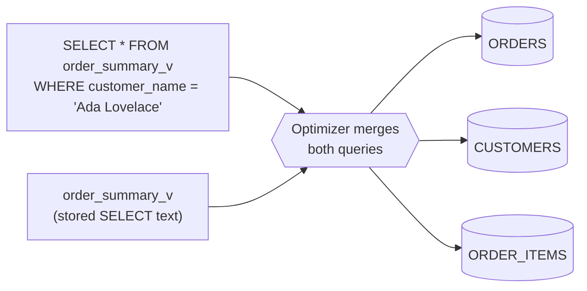

# 4️⃣ Views

> A view is a query with a name. It stores no data — but it can hide complexity, enforce security, and give applications a stable interface while tables evolve underneath.

**Sessions:** 6 · **Time:** ~45 min · **Requires:** sample schema from [lesson 1](01-tables.md)

---

## 📑 Sessions

1. [A view is a stored query](#session-41--a-view-is-a-stored-query)
2. [What views are good for](#session-42--what-views-are-good-for)
3. [Changing data through a view](#session-43--changing-data-through-a-view)
4. [WITH CHECK OPTION and WITH READ ONLY](#session-44--with-check-option-and-with-read-only)
5. [Dependencies and invalid views](#session-45--dependencies-and-invalid-views)
6. [Materialized views: when you *do* want stored data](#session-46--materialized-views-when-you-do-want-stored-data)

---

## Session 4.1 — A view is a stored query

🧠 **Key idea:** a view **stores only its `SELECT` text** in the data dictionary. Every time you query the view, Oracle merges your query with the view's query and runs the result against the base tables. **No segment, no copy of the data.**



🧪 **Try it:**

```sql
CREATE OR REPLACE VIEW order_summary_v AS
SELECT o.order_id,
       o.order_date,
       o.status,
       c.full_name                         AS customer_name,
       COUNT(*)                            AS line_count,
       SUM(oi.quantity * oi.unit_price)    AS order_total
FROM   orders o
JOIN   customers   c  ON c.customer_id = o.customer_id
JOIN   order_items oi ON oi.order_id   = o.order_id
GROUP  BY o.order_id, o.order_date, o.status, c.full_name;

SELECT * FROM order_summary_v ORDER BY order_total DESC;
```

Prove it has no storage:

```sql
SELECT object_name, object_type, status FROM user_objects WHERE object_name = 'ORDER_SUMMARY_V';
SELECT COUNT(*) AS segments FROM user_segments WHERE segment_name = 'ORDER_SUMMARY_V';   -- 0
SELECT text_vc FROM user_views WHERE view_name = 'ORDER_SUMMARY_V';                      -- the stored SQL
```

> [!TIP]
> Always use **`CREATE OR REPLACE VIEW`**. It redefines the view in place and **keeps the grants** on it. `DROP` + `CREATE` loses them.

---

## Session 4.2 — What views are good for

🧠 **Key idea:** views are an **abstraction layer**. Four classic reasons to create one:

| Purpose | Example |
|---------|---------|
| 🧩 **Hide complexity** | `order_summary_v` above: callers don't need to know the joins |
| 🔒 **Security: columns** | Expose `customers` without `email` to reporting users |
| 🔒 **Security: rows** | Show only one country's customers (`WHERE country_code = 'GB'`) |
| 🛡️ **Stable interface** | Rename or split tables; keep the view's shape so applications don't break |

🧪 **Try it** — a column-restricted view for a reporting user:

```sql
CREATE OR REPLACE VIEW customers_public_v AS
SELECT customer_id, full_name, country_code
FROM   customers;
-- GRANT SELECT ON customers_public_v TO reporting_user;   -- they never see emails
```

> [!WARNING]
> **Avoid `SELECT *` in view definitions.** Oracle expands `*` into an explicit column list **when the view is created**. Columns added to the table later will *not* appear in the view until you recreate it, which surprises everyone.

> [!NOTE]
> **Views on views on views** get hard to tune and reason about. If you need more than two levels, rethink the design.

---

## Session 4.3 — Changing data through a view

🧠 **Key idea:** you can `INSERT`, `UPDATE`, and `DELETE` through a view **if Oracle can trace each view row back to exactly one row of one base table**.

| View contains | DML allowed? |
|---------------|:------------:|
| One table, plain columns | ✅ |
| `DISTINCT`, `GROUP BY`, aggregates, `UNION`, `ROWNUM` | ❌ |
| Calculated columns (`qty * price`) | Other columns ✅, the calculated one ❌ |
| A join | Only columns of the **key-preserved** table |

A table is **key-preserved** when its primary key is still unique in the view's result. In a join of `order_items` → `products`, each order item appears at most once, so `order_items` is key-preserved; each product can appear many times, so `products` is not.

🧪 **Try it:**

```sql
CREATE OR REPLACE VIEW order_lines_v AS
SELECT oi.order_id, oi.line_no, oi.quantity,
       p.name       AS product_name,
       p.unit_price AS list_price
FROM   order_items oi
JOIN   products    p ON p.product_id = oi.product_id;

-- Ask Oracle which columns are updatable
SELECT column_name, updatable, insertable, deletable
FROM   user_updatable_columns
WHERE  table_name = 'ORDER_LINES_V';

UPDATE order_lines_v SET quantity = quantity + 1 WHERE order_id = (SELECT MIN(order_id) FROM orders) AND line_no = 1;
-- ✅ 1 row updated (order_items is key-preserved)

UPDATE order_lines_v SET product_name = 'Renamed';
-- ❌ ORA-01779: cannot modify a column which maps to a non key-preserved table

ROLLBACK;
```

> [!TIP]
> When a view isn't updatable but you still need it to accept DML, an **`INSTEAD OF` trigger** can translate the DML to the base tables. Use it sparingly — it hides logic.

---

## Session 4.4 — WITH CHECK OPTION and WITH READ ONLY

🧠 **Key idea:** a row-filtering view does **not**, by default, stop you from writing rows that the view itself can't see. Two clauses fix that.

🧪 **Try it** — the "disappearing row" problem:

```sql
CREATE OR REPLACE VIEW gb_customers_v AS
SELECT customer_id, email, full_name, country_code
FROM   customers
WHERE  country_code = 'GB';

INSERT INTO gb_customers_v (email, full_name, country_code)
VALUES ('tim@example.com', 'Tim Berners-Lee', 'US');
-- ✅ 1 row created ... but it's not a GB customer!

SELECT * FROM gb_customers_v WHERE email = 'tim@example.com';   -- no rows 👻
ROLLBACK;
```

Fix it with **`WITH CHECK OPTION`**:

```sql
CREATE OR REPLACE VIEW gb_customers_v AS
SELECT customer_id, email, full_name, country_code
FROM   customers
WHERE  country_code = 'GB'
WITH CHECK OPTION CONSTRAINT gb_customers_v_ck;

INSERT INTO gb_customers_v (email, full_name, country_code)
VALUES ('tim@example.com', 'Tim Berners-Lee', 'US');
-- ❌ ORA-01402: view WITH CHECK OPTION where-clause violation
```

Or forbid writes entirely with **`WITH READ ONLY`**:

```sql
CREATE OR REPLACE VIEW customers_public_v AS
SELECT customer_id, full_name, country_code
FROM   customers
WITH READ ONLY;

UPDATE customers_public_v SET full_name = 'X';   -- ❌ fails: read-only view
```

| Clause | Effect |
|--------|--------|
| *(none)* | DML allowed, even for rows outside the `WHERE` |
| `WITH CHECK OPTION` | DML allowed only if the resulting row is visible through the view |
| `WITH READ ONLY` | No DML at all |

---

## Session 4.5 — Dependencies and invalid views

🧠 **Key idea:** a view **depends** on its base tables. If you change a table in a way that affects the view, the view becomes **`INVALID`**. Oracle tries to recompile it automatically the next time it's used — that only works if the view's SQL is still valid.

🧪 **Try it:**

```sql
CREATE OR REPLACE VIEW product_names_v AS
SELECT product_id, name FROM products;

-- What does the view depend on?
SELECT name, type, referenced_name, referenced_type
FROM   user_dependencies
WHERE  name = 'PRODUCT_NAMES_V';

-- Break it
ALTER TABLE products RENAME COLUMN name TO product_name;

SELECT object_name, status FROM user_objects WHERE object_name IN ('PRODUCT_NAMES_V', 'ORDER_LINES_V');
-- INVALID, INVALID

SELECT * FROM product_names_v;
-- ❌ ORA-04063: view "RDBMS_DEV.PRODUCT_NAMES_V" has errors

-- Repair
ALTER TABLE products RENAME COLUMN product_name TO name;
ALTER VIEW product_names_v COMPILE;
SELECT object_name, status FROM user_objects WHERE object_name = 'PRODUCT_NAMES_V';   -- VALID
```

> [!NOTE]
> Since 11g, Oracle tracks dependencies **per column**. Adding a column to `products` doesn't invalidate `product_names_v`; renaming or dropping a column the view actually uses does.

> [!TIP]
> After every deployment, check for broken objects:
> ```sql
> SELECT object_type, object_name FROM user_objects WHERE status = 'INVALID';
> ```
> Need to create a view before its table exists (e.g. ordering problems in deploy scripts)? `CREATE FORCE VIEW` creates it in `INVALID` state; it becomes valid once the table exists.

---

## Session 4.6 — Materialized views: when you *do* want stored data

🧠 **Key idea:** a **materialized view (MV)** runs its query once and **stores the result in a segment**. Reads are fast (no joins at query time), but the data is only as fresh as the last refresh.

| | View | Materialized view |
|---|---|---|
| Stores data | ❌ | ✅ (has a segment) |
| Always current | ✅ | ❌ until refreshed |
| Query cost | Runs the full query every time | Reads the precomputed result |
| Typical use | Abstraction, security | Reporting, dashboards, replication |

🧪 **Try it:**

```sql
CREATE MATERIALIZED VIEW sales_by_category_mv
  BUILD IMMEDIATE
  REFRESH COMPLETE ON DEMAND
AS
SELECT p.category,
       SUM(oi.quantity)                 AS units_sold,
       SUM(oi.quantity * oi.unit_price) AS revenue
FROM   order_items oi
JOIN   products    p ON p.product_id = oi.product_id
GROUP  BY p.category;

SELECT * FROM sales_by_category_mv;
SELECT segment_name, segment_type FROM user_segments WHERE segment_name = 'SALES_BY_CATEGORY_MV';   -- it has a segment!

-- Later, after data changes:
EXEC DBMS_MVIEW.REFRESH('SALES_BY_CATEGORY_MV');
```

> [!NOTE]
> MVs support **fast (incremental) refresh** using MV logs, and **query rewrite**, where the optimizer silently answers a query on the base tables from the MV. Both are topics for a follow-up course.

Clean up:

```sql
DROP MATERIALIZED VIEW sales_by_category_mv;
DROP VIEW product_names_v;
```

---

## ✅ Check yourself

<details>
<summary><b>1.</b> How much disk space does a view on a 50 GB table use?</summary>

**None** (apart from a dictionary entry). A view stores only its SQL text. A *materialized* view is different.
</details>

<details>
<summary><b>2.</b> You add a column to a table. A view defined as <code>SELECT * FROM that_table</code> doesn't show it. Why?</summary>

Oracle expanded `*` into a fixed column list when the view was created. Recreate the view (`CREATE OR REPLACE VIEW ...`) to pick up the new column — and better, list the columns explicitly.
</details>

<details>
<summary><b>3.</b> Through a view with <code>WHERE status = 'NEW'</code>, you update a row to <code>status = 'PAID'</code>. With and without <code>WITH CHECK OPTION</code>, what happens?</summary>

Without: the update succeeds, and the row disappears from the view. With: it fails with `ORA-01402`.
</details>

<details>
<summary><b>4.</b> What's the difference between <code>CREATE OR REPLACE VIEW</code> and <code>DROP VIEW</code> + <code>CREATE VIEW</code>?</summary>

`CREATE OR REPLACE` keeps existing **grants** and dependent objects' references. Drop + create loses the grants and invalidates dependents.
</details>

---

<p align="center"><a href="03-indexes.md">← Indexes</a> · <a href="../README.md">🏠 Home</a> · <a href="05-sequences.md">Next: Sequences →</a></p>
