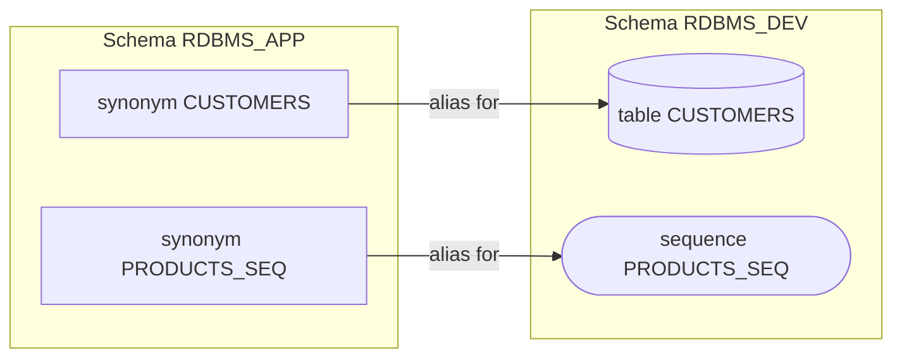
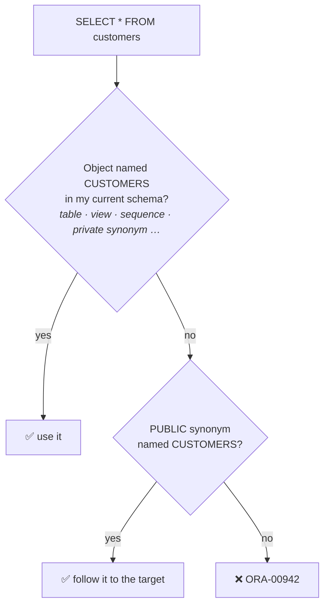

# 6️⃣ Synonyms

> A synonym is a nickname for an object. It lets an application say `customers` instead of `rdbms_dev.customers` — and lets you repoint that name without touching application code.

**Sessions:** 5 · **Time:** ~30 min · **Requires:** sample schema from [lesson 1](01-tables.md) and the `RDBMS_APP` user from [setup](00-setup.md#session-02--create-the-training-users)

---

## 📑 Sessions

1. [What a synonym is](#session-61--what-a-synonym-is)
2. [A synonym is not a permission](#session-62--a-synonym-is-not-a-permission)
3. [Private vs public synonyms](#session-63--private-vs-public-synonyms)
4. [How Oracle resolves a name](#session-64--how-oracle-resolves-a-name)
5. [Use cases and gotchas](#session-65--use-cases-and-gotchas)

---

## Session 6.1 — What a synonym is

🧠 **Key idea:** a synonym is an **alias** for a table, view, sequence, procedure, package, or even another synonym. It stores only the target's name — **no data, no segment**, and not even a check that the target exists.



The typical setup: one schema **owns** the objects (`RDBMS_DEV`), and the application connects as a different, low-privileged user (`RDBMS_APP`). Synonyms let the application use short names.

---

## Session 6.2 — A synonym is not a permission

🧠 **Key idea:** a synonym only answers *"where is it?"*. Whether you're **allowed** to use it is decided by **grants** on the target object.

🧪 **Try it** — connect as `RDBMS_APP`:

```sql
SELECT * FROM customers;
-- ❌ ORA-00942: table or view does not exist

SELECT * FROM rdbms_dev.customers;
-- ❌ ORA-00942: table or view does not exist   (no privilege yet → Oracle pretends it doesn't exist)
```

As `RDBMS_DEV`, grant access:

```sql
GRANT SELECT ON customers TO rdbms_app;
GRANT SELECT ON products_seq TO rdbms_app;   -- sequences need SELECT to use NEXTVAL
```

Back as `RDBMS_APP`:

```sql
SELECT full_name FROM rdbms_dev.customers;   -- ✅ works with the full name

CREATE SYNONYM customers    FOR rdbms_dev.customers;
CREATE SYNONYM products_seq FOR rdbms_dev.products_seq;

SELECT full_name FROM customers;            -- ✅ works with the short name
SELECT products_seq.NEXTVAL FROM dual;      -- ✅
```

Now take the privilege away (as `RDBMS_DEV`):

```sql
REVOKE SELECT ON customers FROM rdbms_app;
```

As `RDBMS_APP`, the synonym still exists, but:

```sql
SELECT full_name FROM customers;
-- ❌ ORA-00942: table or view does not exist
```

> [!IMPORTANT]
> `ORA-00942` means **"doesn't exist *or* you're not allowed to see it"**. Oracle deliberately doesn't tell you which. When debugging, check the grants first: `SELECT * FROM all_tab_privs WHERE table_name = 'CUSTOMERS';`

Restore it for the remaining sessions (as `RDBMS_DEV`):

```sql
GRANT SELECT ON customers TO rdbms_app;
```

---

## Session 6.3 — Private vs public synonyms

🧠 **Key idea:** a **private** synonym belongs to one schema. A **public** synonym belongs to the special group `PUBLIC` and is visible to **every user in the database**.

| | Private | Public |
|---|---|---|
| Created with | `CREATE SYNONYM s FOR ...` | `CREATE PUBLIC SYNONYM s FOR ...` |
| Owned by | A schema | `PUBLIC` |
| Visible to | That schema (and anyone who qualifies it: `schema.s`) | Everyone |
| Privilege needed | `CREATE SYNONYM` | `CREATE PUBLIC SYNONYM` (DBA-level) |
| Recommended for apps | ✅ | ⚠️ Rarely |

🧪 **Try it** (needs the optional grant from setup), as `RDBMS_DEV`:

```sql
CREATE PUBLIC SYNONYM shop_products FOR rdbms_dev.products;

SELECT owner, synonym_name, table_owner, table_name
FROM   all_synonyms
WHERE  synonym_name = 'SHOP_PRODUCTS';
-- OWNER = PUBLIC

DROP PUBLIC SYNONYM shop_products;
```

> [!WARNING]
> **Be careful with public synonyms.** They live in a single namespace shared by the whole database, so two applications can't both have a public `CUSTOMERS`. They also make it hard to tell which object a name refers to. Oracle itself uses them for things like `DUAL` and `DBMS_OUTPUT`. For your own applications, **prefer private synonyms**.

---

## Session 6.4 — How Oracle resolves a name

🧠 **Key idea:** when you write an **unqualified** name (`customers`, not `x.customers`), Oracle looks in this order:



Consequences:

- A **local object always wins** over a public synonym. Creating a table called `DUAL` in your schema would (very confusingly) hide the real one.
- Tables, views, sequences and private synonyms share **one namespace** per schema. You can't have a table *and* a private synonym both named `CUSTOMERS` in the same schema → `ORA-00955: name is already used by an existing object`.
- A **qualified** name (`rdbms_dev.customers`) skips the search entirely.

> [!TIP]
> **An alternative to many synonyms:** switch your session's default schema.
> ```sql
> ALTER SESSION SET CURRENT_SCHEMA = rdbms_dev;
> SELECT * FROM customers;   -- now means rdbms_dev.customers
> ```
> This changes only **name resolution**, not privileges — you still need the grants. Many applications run this right after connecting instead of maintaining dozens of synonyms.

---

## Session 6.5 — Use cases and gotchas

🧠 **Key idea:** synonyms are a layer of **indirection**. That's useful when it's intentional and confusing when it isn't.

**Good use cases:**

| Use case | Example |
|----------|---------|
| Short names for the app user | `CREATE SYNONYM customers FOR rdbms_dev.customers;` |
| Hide a remote database | `CREATE SYNONYM remote_rates FOR fx_rates@finance_db;` |
| Switch between versions of an object | Load `customers_v2`, then `CREATE OR REPLACE SYNONYM customers FOR rdbms_dev.customers_v2;` — the app switches over immediately |

**Gotchas:**

🧪 **Try it** — synonyms can point to nothing (as `RDBMS_APP`):

```sql
CREATE SYNONYM ghost FOR rdbms_dev.does_not_exist;   -- ✅ created without complaint!
SELECT * FROM ghost;
-- ❌ ORA-00980: synonym translation is no longer valid
```

> [!WARNING]
> - **Dangling synonyms:** dropping or renaming the target leaves the synonym behind, broken. Find them with:
>   ```sql
>   SELECT s.synonym_name, s.table_owner, s.table_name
>   FROM   user_synonyms s
>   WHERE  NOT EXISTS (SELECT 1 FROM all_objects o
>                      WHERE  o.owner = s.table_owner AND o.object_name = s.table_name);
>   ```
>   (Synonyms that go through a database link show up here too — check those by hand.)
> - **Chains:** a synonym can point to another synonym. It works, but every extra hop makes debugging harder. Point straight at the real object.
> - **Not for columns:** synonyms exist for objects only. To rename *columns* for an application, use a [view](04-views.md).

Inspect what you have:

```sql
SELECT synonym_name, table_owner, table_name, db_link FROM user_synonyms;
```

Clean up (as `RDBMS_APP`):

```sql
DROP SYNONYM ghost;
```

---

## ✅ Check yourself

<details>
<summary><b>1.</b> You create a synonym for another schema's table, but querying it fails with ORA-00942. What's missing?</summary>

A **grant** on the target table (e.g. `GRANT SELECT ON rdbms_dev.customers TO rdbms_app`). A synonym is a name, not a permission.
</details>

<details>
<summary><b>2.</b> Your schema has a table <code>ORDERS</code>, and there's also a public synonym <code>ORDERS</code> pointing elsewhere. Which does <code>SELECT * FROM orders</code> use?</summary>

**Your own table.** Objects in the current schema are found before public synonyms.
</details>

<details>
<summary><b>3.</b> Does <code>CREATE SYNONYM x FOR y.z</code> fail if <code>y.z</code> doesn't exist?</summary>

**No.** It's created anyway. Using it later fails with `ORA-00980`.
</details>

<details>
<summary><b>4.</b> Name an alternative to creating a private synonym for every table the app uses.</summary>

`ALTER SESSION SET CURRENT_SCHEMA = owner_schema;` right after connecting. It changes name resolution for the session, but not privileges.
</details>

---

## 🎉 You made it!

You now know the core building blocks of every Oracle schema:

| Object | One-line summary |
|--------|------------------|
| **Table** | A heap of rows, protected by constraints |
| **Segment** | The storage an object owns: extents of blocks, up to a high water mark |
| **Index** | A sorted B-tree of keys → ROWIDs. Fast reads, slower writes |
| **View** | A named query. No storage, but a powerful abstraction |
| **Sequence** | A fast, gap-tolerant number generator outside transactions |
| **Synonym** | An alias. Location, not permission |

Keep the [cheat sheet](99-cheatsheet.md) handy.

---

<p align="center"><a href="05-sequences.md">← Sequences</a> · <a href="../README.md">🏠 Home</a> · <a href="99-cheatsheet.md">Cheat Sheet →</a></p>
