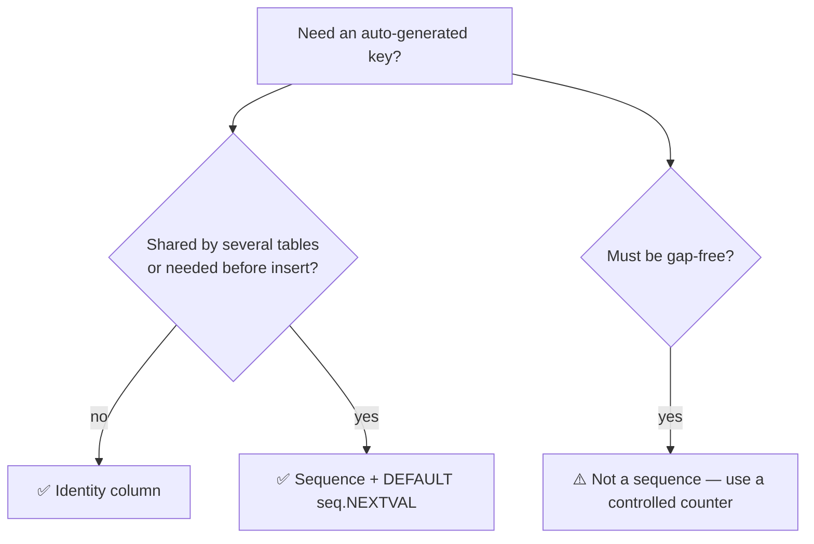

# 📋 Cheat Sheet

> Everything from the course on one page. Bookmark it.

---

## 🧱 Objects at a glance

| Object | Stores data? | Key dictionary view | Create | Drop |
|--------|:-----------:|---------------------|--------|------|
| Table | ✅ | `USER_TABLES`, `USER_TAB_COLUMNS` | `CREATE TABLE t (...)` | `DROP TABLE t [PURGE]` |
| Constraint | — | `USER_CONSTRAINTS`, `USER_CONS_COLUMNS` | `ALTER TABLE t ADD CONSTRAINT ...` | `ALTER TABLE t DROP CONSTRAINT c` |
| Segment | ✅ | `USER_SEGMENTS`, `USER_EXTENTS` | *(automatic, on first insert)* | *(with its object)* |
| Index | ✅ | `USER_INDEXES`, `USER_IND_COLUMNS`, `USER_IND_EXPRESSIONS` | `CREATE [UNIQUE] INDEX i ON t (c)` | `DROP INDEX i` |
| View | ❌ | `USER_VIEWS`, `USER_UPDATABLE_COLUMNS` | `CREATE OR REPLACE VIEW v AS ...` | `DROP VIEW v` |
| Materialized view | ✅ | `USER_MVIEWS` | `CREATE MATERIALIZED VIEW mv ...` | `DROP MATERIALIZED VIEW mv` |
| Sequence | ❌ | `USER_SEQUENCES` | `CREATE SEQUENCE s` | `DROP SEQUENCE s` |
| Identity column | ❌ (uses a sequence) | `USER_TAB_IDENTITY_COLUMNS` | `... GENERATED ALWAYS AS IDENTITY` | *(with its table)* |
| Synonym | ❌ | `USER_SYNONYMS`, `ALL_SYNONYMS` | `CREATE [OR REPLACE] [PUBLIC] SYNONYM s FOR o` | `DROP [PUBLIC] SYNONYM s` |

**Dictionary prefixes:** `USER_` = mine · `ALL_` = what I can access · `DBA_` = everything (needs privileges).

**Any object:** `USER_OBJECTS` (type, status, created, last DDL) · `USER_DEPENDENCIES` (what depends on what).

---

## 🔎 Handy queries

```sql
-- What do I own, and is anything broken?
SELECT object_type, object_name, status FROM user_objects ORDER BY object_type, object_name;
SELECT object_type, object_name FROM user_objects WHERE status = 'INVALID';

-- Columns of a table
SELECT column_name, data_type, char_length, data_precision, data_scale, nullable, data_default
FROM   user_tab_columns WHERE table_name = 'ORDERS' ORDER BY column_id;

-- Constraints of a table
SELECT constraint_name, constraint_type, search_condition_vc, r_constraint_name, status
FROM   user_constraints WHERE table_name = 'ORDERS';

-- Indexes and their columns
SELECT i.index_name, i.uniqueness, i.status, i.visibility,
       LISTAGG(c.column_name, ', ') WITHIN GROUP (ORDER BY c.column_position) AS columns
FROM   user_indexes i JOIN user_ind_columns c ON c.index_name = i.index_name
WHERE  i.table_name = 'ORDERS'
GROUP  BY i.index_name, i.uniqueness, i.status, i.visibility;

-- Foreign keys without an index whose leading column is the FK column
-- (simple check: single-column FKs only)
SELECT c.table_name, c.constraint_name, cc.column_name
FROM   user_constraints c
JOIN   user_cons_columns cc ON cc.constraint_name = c.constraint_name
WHERE  c.constraint_type = 'R'
AND    NOT EXISTS (SELECT 1 FROM user_ind_columns ic
                   WHERE  ic.table_name = cc.table_name
                   AND    ic.column_name = cc.column_name
                   AND    ic.column_position = 1);

-- Space used per object type
SELECT segment_type, COUNT(*) AS segments, ROUND(SUM(bytes)/1024/1024, 1) AS mb
FROM   user_segments GROUP BY segment_type ORDER BY mb DESC;

-- Execution plan
EXPLAIN PLAN FOR SELECT ...;
SELECT * FROM TABLE(DBMS_XPLAN.DISPLAY);

-- Refresh optimizer statistics
EXEC DBMS_STATS.GATHER_TABLE_STATS(USER, 'ORDERS');
```

---

## 🧭 Decision guides

**Generating keys**



**Getting rid of data**

| I want to … | Use |
|-------------|-----|
| Remove some rows, maybe undo | `DELETE ... WHERE ...` |
| Empty a table fast and free its space | `TRUNCATE TABLE t` |
| Remove the table (recoverable) | `DROP TABLE t` → `FLASHBACK TABLE t TO BEFORE DROP` |
| Remove the table for good | `DROP TABLE t PURGE` |
| Release space after a big delete, keep the rows | `ALTER TABLE t ENABLE ROW MOVEMENT; ALTER TABLE t SHRINK SPACE;` |

---

## 🚨 Common errors

| Error | Meaning | First thing to check |
|-------|---------|----------------------|
| `ORA-00001` | Unique constraint violated | Duplicate key; identity/sequence behind manually inserted IDs? |
| `ORA-00942` | Table or view does not exist | Typo, wrong schema, **or missing grant** |
| `ORA-00955` | Name is already used by an existing object | Tables, views, sequences and private synonyms share one namespace |
| `ORA-00980` | Synonym translation is no longer valid | The synonym's target was dropped or never existed |
| `ORA-01400` | Cannot insert NULL into (...) | Missing value for a `NOT NULL` column |
| `ORA-01402` | View WITH CHECK OPTION where-clause violation | The row would fall outside the view |
| `ORA-01536` | Space quota exceeded for tablespace | Ask for more quota |
| `ORA-01779` | Cannot modify a column which maps to a non key-preserved table | Updating the "many" side of a join view |
| `ORA-01950` | No privileges on tablespace | The schema has no quota (surfaces on the first insert) |
| `ORA-02290` | Check constraint violated | The value breaks a `CHECK` rule |
| `ORA-02291` | Integrity constraint violated – parent key not found | FK value doesn't exist in the parent |
| `ORA-02292` | Integrity constraint violated – child record found | Deleting a parent that still has children |
| `ORA-04063` | View has errors | A base table changed; fix it and `ALTER VIEW v COMPILE` |
| `ORA-08002` | Sequence CURRVAL is not yet defined in this session | Call `NEXTVAL` first |
| `ORA-12899` | Value too large for column | `VARCHAR2(n)` is in bytes; use `n CHAR` |
| `ORA-32795` | Cannot insert into a generated always identity column | Don't supply the ID, or use `BY DEFAULT` |
| `ORA-65096` | Invalid common user or role name | You're in the CDB root; connect to the PDB |

---

## 🧠 The 15 things to remember

1. Heap tables have **no inherent order** — always `ORDER BY`.
2. **`''` is `NULL`** in Oracle.
3. **`DATE` includes a time.**
4. `VARCHAR2(n)` is **bytes** by default — write `VARCHAR2(n CHAR)`.
5. **DDL commits** implicitly.
6. **Name your constraints.**
7. **Index your foreign keys.**
8. `TRUNCATE` and `DROP ... PURGE` **can't be undone**.
9. `DELETE` **doesn't lower the high water mark**.
10. Functions on indexed columns **disable** normal indexes — rewrite the query or use a function-based index.
11. B-tree indexes **don't store all-NULL keys**.
12. Views **store no data**; `SELECT *` in a view is frozen at creation.
13. Sequences **have gaps** — by design.
14. Use **`RETURNING ... INTO`** to get generated keys.
15. A synonym is a **name, not a permission**.

---

<p align="center"><a href="06-synonyms.md">← Synonyms</a> · <a href="../README.md">🏠 Home</a></p>
